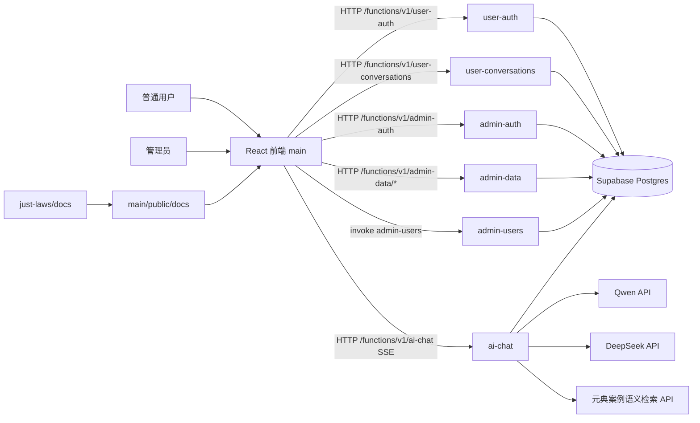
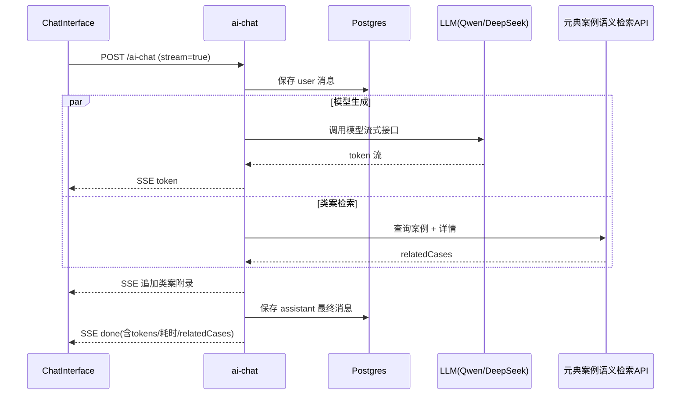
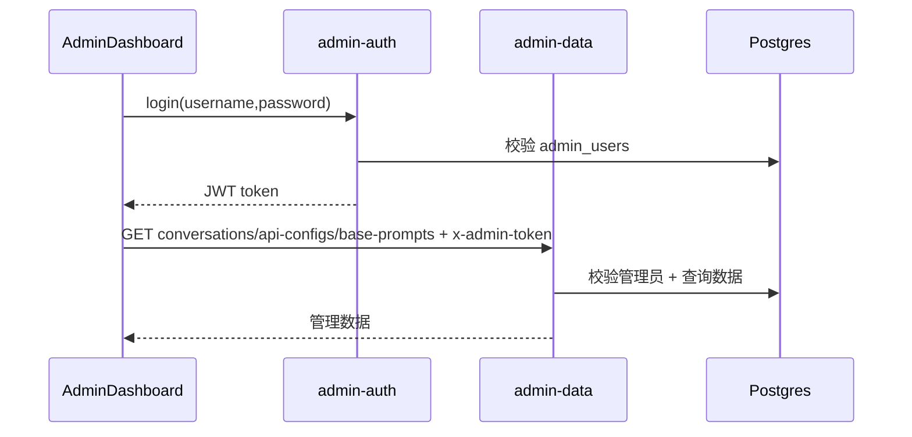

# 法律知识助手项目架构分析报告

> 分析日期：2026-03-19  
> 分析范围：`main/`（前端应用）+ `supabase/`（Edge Functions 与 SQL）+ `just-laws/`（法律文库源）

## 1. 架构总览

该项目采用「前端 SPA + Supabase Edge Functions + Supabase Postgres + 外部模型/案例服务」的分层结构：

1. 前端（`main`）负责用户交互、会话渲染、文档上传解析、管理后台。
2. Supabase Edge Functions 负责鉴权、对话编排、配置管理、用户管理。
3. Supabase Postgres 负责用户、会话、管理员、模型配置、基础提示词持久化。
4. 外部服务包括：
   - 大模型服务：Qwen / DeepSeek（由管理员配置驱动）
   - 元典开放平台案例语义检索 API（类案检索）

## 2. 仓库结构与职责

- `main/`：主前端应用（Vite + React + TS）。
- `supabase/`：数据库建表 SQL、迁移脚本、Edge Functions。
- `just-laws/`：独立法律文库项目（VuePress 文档源），当前仓库里用于提供法规 Markdown 来源。
- `main/public/docs/`：前端法律文库读取的静态法规文件目录。

## 3. 前端架构（`main`）

### 3.1 技术栈

- 框架：React 18 + TypeScript + Vite 6
- 路由：`react-router-dom`
- 样式：Tailwind CSS + Framer Motion
- 后端接入：`@supabase/supabase-js` + 直接 `fetch` Supabase Function
- 文档能力：`pdfjs-dist`（PDF 读取）、`mammoth`（DOCX 读取）、`docx` + `file-saver`（导出 Word）

### 3.2 路由与页面

`App.tsx` 中定义 4 条核心路由：

- `/`：用户聊天页（`ChatInterface`，需用户登录）
- `/login`：用户登录/注册（`UserLogin`）
- `/admin/login`：管理员登录（`AdminLogin`）
- `/admin`：管理后台（`AdminDashboard`，需管理员登录）

路由保护由 `UserContext` 与 `AdminContext` 提供。

### 3.3 状态管理

采用「React Context + 组件本地 state」模式：

- `UserContext`：用户对象、登录/注册/退出，使用 `localStorage('user')` 恢复状态。
- `AdminContext`：管理员对象、JWT token、登录/退出、token 验证，使用 `localStorage('adminToken')`。
- `ThemeContext`：亮暗主题切换，写入 `localStorage`。

### 3.4 核心业务组件

#### A. `ChatInterface.tsx`（用户主工作台）

职责集中在一个大组件：

- 消息发送与流式渲染（SSE token 逐段追加）
- 历史对话加载与关键字搜索定位
- PDF/DOCX 文档上传、读取、长度限制（1000 字符）
- 模型选择（Qwen / DeepSeek）
- 类案检索开关与数量（1~5）
- AI 回复中的相关案例导出 Word
- 法律文库入口（`LawLibrary`）
- 消息侧边栏索引与跳转

#### B. `LawLibrary.tsx`（法规文库）

- 数据索引来自 `lib/lawData.ts`（8 大类，约 31 部法律）
- 内容读取路径为 `/docs/...`（即 `main/public/docs`）
- 支持：分类浏览、章节加载、章节目录、全文渲染（Markdown）
- 搜索策略：遍历法律并逐个抓取法规文件后匹配标题

#### C. 管理后台

- `AdminDashboard.tsx`：概览、对话记录、用户管理、API 配置、基础提示词
- `UserManagement.tsx`：用户列表、启停、删除、详情与最近对话

### 3.5 前端 API 层

- `lib/api.ts`
  - `sendChatMessageStream()`：调用 `ai-chat`，解析 SSE 的 `token/case-status/done/error` 事件
  - `adminAuth`：基于 `supabase.functions.invoke('admin-auth')`
- `lib/adminApi.ts`
  - 管理后台数据接口（`admin-data/*`）
- `lib/supabase.ts`
  - Supabase Client（当前写死 URL/Anon Key）

## 4. 后端架构（`supabase/functions`）

### 4.1 函数职责矩阵

| 函数 | 主要调用方 | 核心职责 |
|---|---|---|
| `user-auth` | 用户登录/注册页 | 用户注册、登录、密码校验、状态检查 |
| `user-conversations` | 聊天页 | 获取用户历史会话 |
| `admin-auth` | 管理员登录 | 管理员登录、创建、JWT 签发与验证 |
| `admin-data` | 管理后台 | 对话统计、API 配置、基础提示词管理 |
| `admin-users` | 用户管理页 | 用户列表、启停、删除、详情 |
| `ai-chat` | 聊天页 | 会话编排、模型调用、类案检索、流式/非流式响应、对话落库 |

### 4.2 `ai-chat` 核心编排流程

1. 校验请求（`message/sessionId` 必填，`caseCount` 限制 1~5）。
2. 从 `api_configs` 获取可用模型配置；根据前端偏好选择 provider。
3. 从 `base_prompts` 读取当前激活系统提示词。
4. 先写入用户消息到 `conversations`。
5. 并发启动类案检索任务（元典语义检索 API）与模型调用任务。
6. 若流式请求：
   - 实时推送模型 token
   - 模型结束后拼接类案附录并继续推送
   - 保存 assistant 最终消息
   - 发送 `done` 事件（含 token/耗时/相关案例等元数据）
7. 若非流式请求：同步调用模型并拼接类案附录后返回 JSON。

### 4.3 管理与认证流程

- `admin-auth` 使用自定义 HMAC JWT（24 小时），并在验证时回查 `admin_users` 是否仍激活。
- `admin-data` 通过 `x-admin-token` 做管理员鉴权，再进行配置/统计读写。
- `admin-users` 当前直接执行管理操作（见第 8 节风险项）。

## 5. 数据模型（Postgres）

核心表：

- `users`：普通用户账号（含 `is_active`、`last_login`）
- `admin_users`：管理员账号
- `conversations`：对话消息（user/assistant）与模型元数据
- `api_configs`：模型供应商配置（provider/key/host/endpoint/model/parameters）
- `base_prompts`：系统提示词配置

关系与策略：

- `conversations.user_id -> users.id` 外键，`ON DELETE CASCADE`。
- 迁移中对 `conversations` 开启了 RLS，并创建了“公开读/公开写”策略。
- 还存在 `admin_profiles` 迁移（与 `auth.users` 关联），但当前主业务未使用该表。

## 6. 关键业务时序

### 6.1 用户聊天（流式）

### 6.2 管理员后台

## 7. 法律文库子系统

1. `just-laws/docs` 是法规源（独立文库项目结构）。
2. 前端实际读取目录是 `main/public/docs`。
3. `LawLibrary` 通过 `lawData.ts` 的分类与目录映射定位 Markdown 文件路径。
4. 搜索按“遍历法律 -> 拉取文件 -> 匹配章节标题”执行，结果回填到侧栏与正文定位。

## 8. 架构风险与技术债（重点）

### 8.1 安全风险（高优先级）

1. 多处敏感信息硬编码：前端 Supabase URL/Anon Key；元典 API Key 现改为读取环境变量 `YUANDIAN_API_KEY`（需在 Supabase 项目中配置 secrets）。  
2. `admin-users` 函数缺少管理员鉴权，且用 Service Role 直连数据库，存在越权风险。  
3. `user-conversations` 仅依据请求体 `userId` 查询，无 token 绑定校验。  
4. `ai-chat` 接收外部传入 `userId` 并落库，缺少身份真实性校验。  
5. 用户密码哈希方案较弱（SHA-256，无慢哈希参数），管理员密码亦为简化实现。  
6. `conversations` 迁移策略为公开读/写（RLS policy），数据暴露面偏大。

### 8.2 设计风险（中优先级）

1. `ChatInterface`、`LawLibrary` 体量较大，UI 状态与业务编排耦合高。  
2. 模型调用、JWT 校验逻辑在多个函数中重复，缺少共享模块。  
3. 法律文库目录映射硬编码，维护成本高，且路径含空格目录。  
4. `admin_profiles` 与当前 `admin_users` 双轨并存，权限模型不统一。

### 8.3 工程化风险（中优先级）

1. 前端 TS `strict: false`，并大量放宽 lint 规则。  
2. 缺少自动化测试（单测/集成/E2E）。  
3. 缺少统一环境配置层（前后端配置读取方式不一致）。

## 9. 优化路线建议

### P0（立即）

1. 移除硬编码密钥，统一改为环境变量与密钥托管。  
2. 为 `admin-users`、`user-conversations`、`ai-chat` 增加强制鉴权与用户身份绑定。  
3. 收紧 `conversations` 的 RLS 策略（最小权限原则）。  
4. 升级密码方案到 `bcrypt/argon2`。

### P1（近期）

1. 抽离共享安全模块（JWT、密码、鉴权中间件）。  
2. 拆分 `ChatInterface`/`LawLibrary`，引入 hooks 与服务层。  
3. 统一配置管理（前端仅走 `import.meta.env`，后端仅走 `Deno.env`）。

### P2（中期）

1. 建立端到端测试覆盖（登录、聊天、历史记录、后台操作）。  
2. 法律目录映射改为配置文件/元数据驱动，降低硬编码。  
3. 补齐可观测性（请求日志、错误追踪、关键指标）。

## 10. 关键文件索引

- 前端入口：`main/src/main.tsx`、`main/src/App.tsx`
- 用户域：`main/src/contexts/UserContext.tsx`、`main/src/components/UserLogin.tsx`
- 聊天主链路：`main/src/components/ChatInterface.tsx`、`main/src/lib/api.ts`
- 文档处理：`main/src/lib/documentReader.ts`、`main/src/lib/exportCase.ts`
- 法律文库：`main/src/components/LawLibrary.tsx`、`main/src/lib/lawData.ts`、`main/public/docs/`
- 管理域：`main/src/contexts/AdminContext.tsx`、`main/src/components/AdminDashboard.tsx`、`main/src/components/UserManagement.tsx`、`main/src/lib/adminApi.ts`
- 核心后端函数：`supabase/functions/ai-chat/index.ts`
- 认证函数：`supabase/functions/user-auth/index.ts`、`supabase/functions/admin-auth/index.ts`
- 管理函数：`supabase/functions/admin-data/index.ts`、`supabase/functions/admin-users/index.ts`
- 会话函数：`supabase/functions/user-conversations/index.ts`
- 数据库定义：`supabase/tables/*.sql`、`supabase/migrations/*.sql`

---

如果你愿意，我下一步可以基于本报告直接输出一份“分阶段改造 PR 计划（按文件拆任务）”，让你可以按周推进落地。
